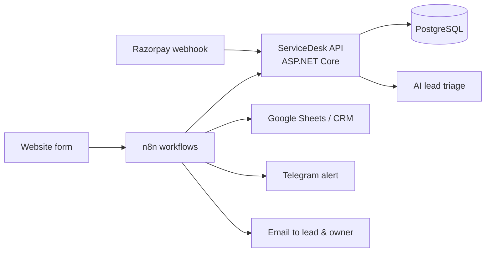

# ServiceDesk — Lead-to-Payment Automation Demo

A portfolio system for a fictional coaching business, **"Bright Path Coaching"**, built in public by
[Narasimha Murthy SN](https://github.com/narasimhasn06) to show four freelance services working together.

## The problem

Leads arrive from a website form and get copied into a spreadsheet by hand. Replies take hours,
payments are checked manually, and the owner has no daily overview of leads, bookings or revenue.

## The solution, layer by layer

| Layer | Folder | Service it demonstrates | Status |
|---|---|---|---|
| ASP.NET Core Web API + PostgreSQL | [`/api`](api) | .NET development | 🚧 Days 2–5 |
| n8n workflows: intake, CRM sync, daily report | [`/automations`](automations) | Workflow automation | ⏳ Days 6–8 |
| SQL tuning + Razorpay webhook integration | [`/sql`](sql) | Database & API work | ⏳ Days 9–10 |
| AI lead triage with guardrails | [`/ai`](ai) | AI integration | ⏳ Days 11–12 |

## Architecture

## Tech stack

C# · ASP.NET Core (.NET 10 LTS) · Entity Framework Core · PostgreSQL · n8n · Docker ·
Razorpay (test mode) · OpenAI / Gemini via Microsoft.Extensions.AI

## Run locally

Setup instructions will be added as each layer ships. Requirements: .NET 10 SDK, Docker Desktop, Node.js LTS.

## Case studies

- [ServiceDesk API](docs/case-studies/01-servicedesk-api.md) (draft)

## Status

🚧 Being built in public over 15 days (started November 2026). Live links are added as each layer ships.

---

**Narasimha Murthy SN** — AI Generalist & Automation Developer.
I connect your forms, CRM, database and AI so work happens without copy-paste.
