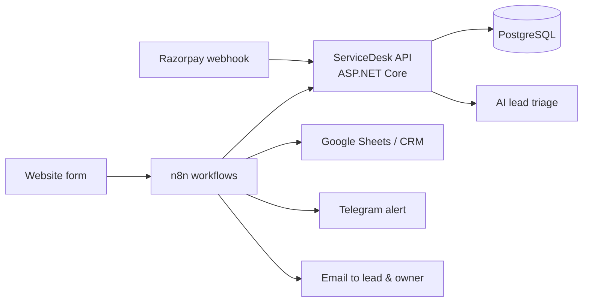

# ServiceDesk — Lead-to-Payment Automation Demo

A portfolio system for a fictional coaching business, **"Bright Path Coaching"**, built in public by
[Narasimha Murthy SN](https://github.com/narasimhasn06) to show four freelance services working together.

## Live demo

- 🌐 API docs: https://servicedesk-api-tpzr.onrender.com/scalar
- 📮 Postman / Insomnia: import `https://servicedesk-api-tpzr.onrender.com/openapi/v1.json`, then add an `X-Api-Key` header.
- ❤️ Health: https://servicedesk-api-tpzr.onrender.com/health
- 🔑 Endpoints require an `X-Api-Key` header — contact me for a demo key.
- ⏳ Hosted on a free plan: the first request after 15 idle minutes can take up to a minute while the service wakes up.

## The problem

Leads arrive from a website form and get copied into a spreadsheet by hand. Replies take hours,
payments are checked manually, and the owner has no daily overview of leads, bookings or revenue.

## The solution, layer by layer

| Layer | Folder | Service it demonstrates | Status |
|---|---|---|---|
| ASP.NET Core Web API + PostgreSQL | [`/api`](api) | .NET development | ✅ Live |
| n8n workflows: intake, CRM sync, alerts, daily report | [`/automations`](automations) | Workflow automation | ✅ Intake, CRM sync, alerts, daily report |
| SQL tuning + Razorpay webhook integration | [`/sql`](sql) | Database & API work | ⏳ Days 9–10 |
| AI lead triage with guardrails | [`/ai`](ai) | AI integration | ⏳ Days 11–12 |

## Architecture

## Tech stack

C# · ASP.NET Core (.NET 10 LTS) · Entity Framework Core · PostgreSQL (Neon) · n8n · Docker (Render) · GitHub Actions ·
Razorpay (test mode) · OpenAI / Gemini via Microsoft.Extensions.AI

## Run locally

Requirements: .NET 10 SDK, Docker Desktop.

1. Copy `.env.example` to `.env` and set a password.
2. Start PostgreSQL: `docker compose up -d`
3. Restore tools: `dotnet tool restore`
4. Set the connection string (same password):
   `dotnet user-secrets set "ConnectionStrings:ServiceDesk" "Host=localhost;Port=5432;Database=servicedesk;Username=servicedesk;Password=<your-password>" --project api/src/ServiceDesk.Api`
5. Run: `dotnet run --project api/src/ServiceDesk.Api --launch-profile https`
6. Open `https://localhost:7086/scalar` — migrations and sample data are applied automatically in Development.

## Case studies

- [ServiceDesk API — a documented, tested backend, live with Docker](docs/case-studies/01-servicedesk-api.md)
- [Automated lead handling — from form to CRM, owner alerts and a daily report, with no copy-paste](docs/case-studies/02-lead-automation.md)

## Status

🚧 Being built in public over 15 days (started November 2026). The API layer is live; n8n lead intake, Google Sheets CRM sync, Telegram alerts, error handling and the 8 AM daily report are done; SQL work, the payment webhook and AI triage follow.

---

**Narasimha Murthy SN** — AI Generalist & Automation Developer.
I connect your forms, CRM, database and AI so work happens without copy-paste.
