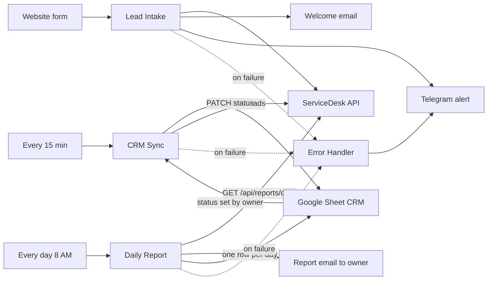
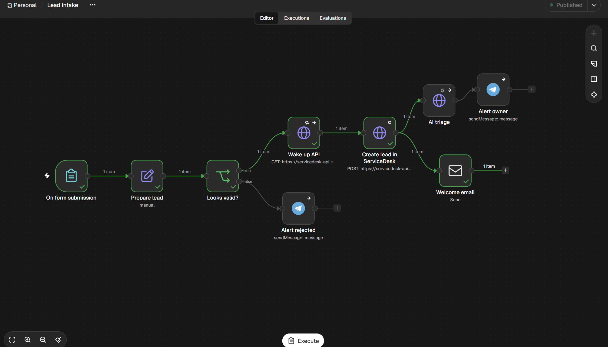
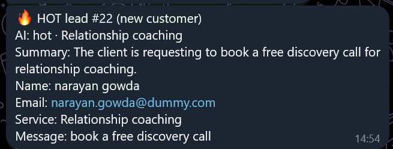
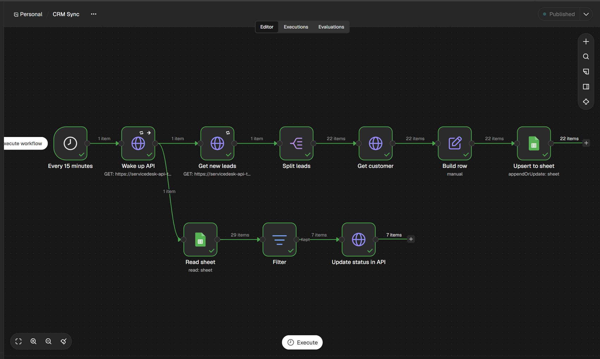
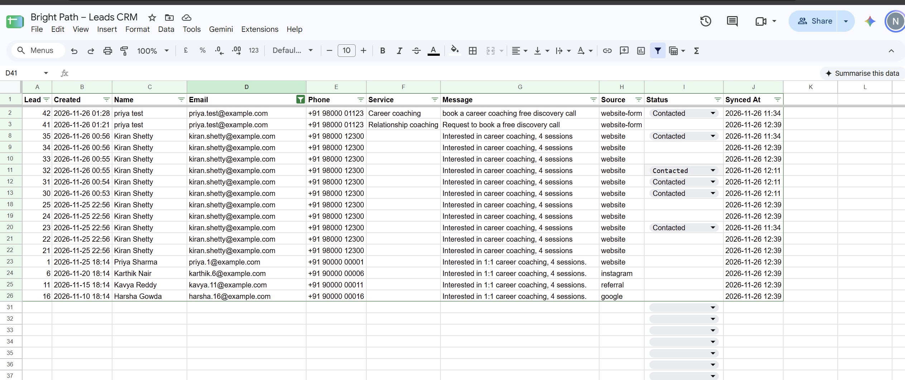
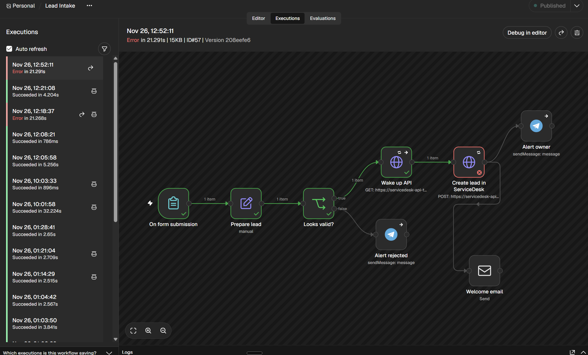
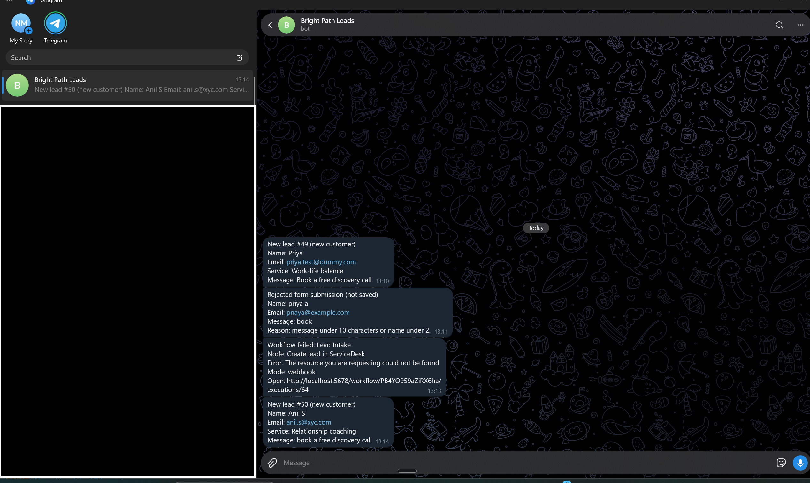
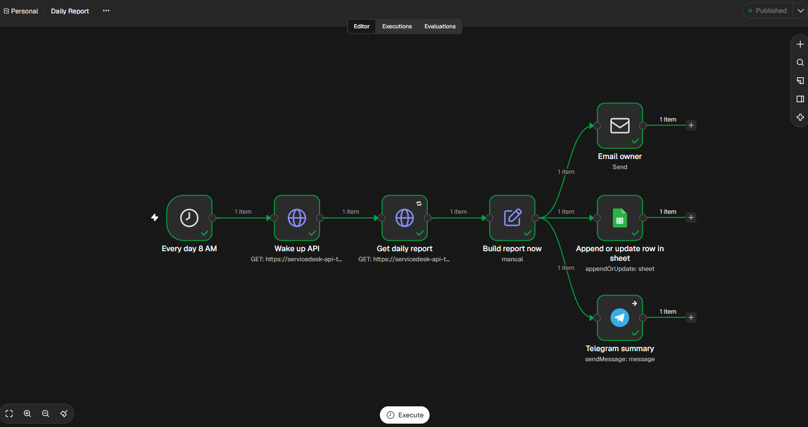
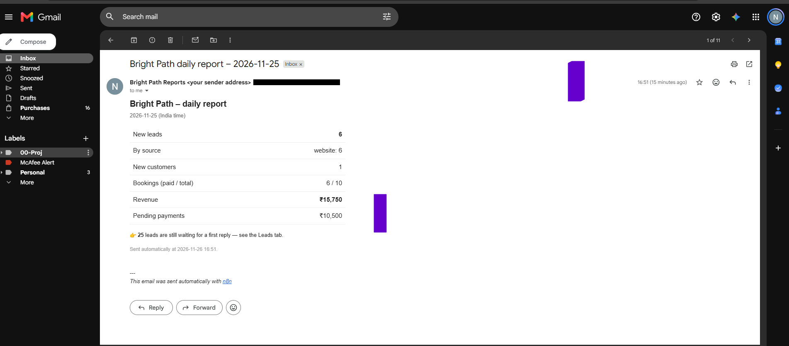
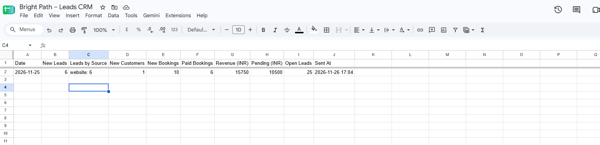

# Automations (n8n)

Four n8n workflows connect the website form, the ServiceDesk API, a Google Sheet "CRM", email and Telegram, so no lead is copied by hand, the owner starts each day with yesterday's numbers, and no failure goes unnoticed.

▶️ **90-second demo:** https://www.loom.com/share/3dd8788069004ab7909ea9e9407cc0e3 · 📄 Case study: [Automated lead handling](../docs/case-studies/02-lead-automation.md)

| Workflow | File | What it does | Status |
|---|---|---|---|
| Lead Intake | [`lead-intake.json`](lead-intake.json) | Website form → validated lead in the API → welcome email + AI triage → Telegram alert (🔥 for hot leads) | ✅ Done |
| CRM Sync | [`crm-sync.json`](crm-sync.json) | Every 15 min: new leads → Google Sheet (no duplicates); owner's status changes → API | ✅ Done |
| Error Handler | [`error-handler.json`](error-handler.json) | Telegram alert when any workflow fails | ✅ Done |
| Daily Report | [`daily-report.json`](daily-report.json) | Every day 8 AM (IST): yesterday's leads, bookings and revenue → owner email + *Reports* tab | ✅ Done |



## 1. Lead Intake



**Problem:** enquiries from the website sat in an inbox until someone copied them into a spreadsheet, and replies took hours.

**Result:** every submission is cleaned, checked, saved as a lead (and customer) through the API, answered by email and announced to the owner on Telegram within seconds.

1. **On form submission** (Form Trigger): "Book a free discovery call" form with Name, Email, Phone, Service and Message.
2. **Prepare lead** (Edit Fields): trims values, lower-cases the email, prefixes the message with the chosen service, sets `source = website-form`.
3. **Looks valid?** (If): message at least 10 characters and name at least 2.
   - **false → Alert rejected** (Telegram): "Rejected form submission (not saved)". Nothing reaches the API.
4. **Wake up API** (HTTP GET `/health`): wakes the free-plan Render service (cold start up to ~1 minute); 60 s timeout, 5 retries, continues on error.
5. **Create lead in ServiceDesk** (HTTP POST `/api/leads/intake`, `X-Api-Key` header auth): finds or creates the customer by email and creates the lead in one transaction; 5 retries. Returns `leadId`, `customerId`, `isNewCustomer`.
6. **Welcome email** (SMTP) goes out straight away. In parallel, **AI triage** (HTTP POST `/api/leads/{leadId}/triage`, 60 s timeout, continues on error) asks the API for the AI's priority, service and summary ([details](../ai/README.md)).
7. **Alert owner** (Telegram) then reports the lead: "🔥 HOT lead #…" for hot leads, otherwise "New lead #…", plus `AI: priority · service` and the one-line summary. If the AI needed human review the alert says so; if the API couldn't be reached it says "AI: not available". The owner gets every lead either way. Telegram nodes continue on error, so a chat hiccup never fails a saved lead.



## 2. CRM Sync



**Problem:** the owner works from a spreadsheet, but the database is the source of truth. Copying between them by hand creates duplicates and stale statuses.

**Result:** the sheet fills itself every 15 minutes, and a status the owner picks in the sheet (Contacted / Qualified / Lost) reaches the API automatically.

```
Every 15 minutes → Wake up API ─┬─ A: Get new leads (with customer) → Split leads → Build row → Upsert to sheet
                                └─ B: Read sheet → Filter (Status not empty) → Update status in API
```

- **Branch A** gets `GET /api/leads/with-customer?status=New&pageSize=100`: every open lead **with** its customer's name, email and phone in **one** API call (one SQL JOIN). Until Day 9 it called `GET /api/customers/{id}` once per lead, a classic N+1 ([details](../sql/README.md#also-fixed-an-n1-in-the-crm-sync)). It builds a row (Lead ID, Created in IST, Name, Email, Phone, Service, Message, Source, Synced At) and **appends or updates** it in the sheet, **matched on Lead ID**, so re-runs never duplicate rows. Values are written raw, so phone numbers like `+91 …` aren't read as formulas.
- **Branch B** reads the sheet and, for every row with a Status, calls `PATCH /api/leads/{id}/status`.
- **Design rule:** branch A never writes the Status column. The owner owns it; n8n only passes it on. So the two branches can't overwrite each other, whichever runs first. A blank Status means *New*.
- Every API call has 5 retries; Google access uses a **service account** shared on the sheet (no personal login, no 7-day token expiry).



**Known limits:** one page of 100 new leads per run; the sheet is the owner's working list of open leads, so a lead that is no longer *New* isn't re-added if its row is deleted; the schedule runs only while n8n is running (a hosted n8n fixes that for a real client).

## 3. Error Handler



**Error Trigger → Alert me** (Telegram): workflow name, failing node, error message, mode and a link to the execution. Set as the *Error workflow* in the settings of Lead Intake, CRM Sync and Daily Report. In n8n 2.x the error workflow must be **published**, and it fires only for production runs (published workflows), not for test runs in the editor.



## 4. Daily Report



**Problem:** the owner had no daily view of the business; counting yesterday's leads and payments meant scrolling through the inbox and the sheet.

**Result:** every morning at 8 AM (India time) an email arrives with yesterday's new leads by source, new customers, bookings (paid / total), revenue, pending payments and how many leads still wait for a first reply. The same numbers are saved as one row per day in a *Reports* tab.

```
Every day 8 AM → Wake up API → Get daily report → Build report now ─┬─ Append or update row in sheet
                                                                    ├─ Email owner
                                                                    └─ Telegram summary
```

- **Get daily report** calls `GET /api/reports/daily` (no date = yesterday). **The API does the counting, n8n does the delivery**: totals come from one SQL-backed, unit-tested endpoint, so the email, the sheet and any future dashboard always agree.
- **"Yesterday" means yesterday in India**, not in UTC. The database stores UTC; the API turns an Indian calendar day into a UTC range (00:00 IST = 18:30 UTC the evening before). n8n runs with `GENERIC_TIMEZONE=Asia/Kolkata`, so 8 AM is 8 AM IST.
- **Revenue** = bookings created that day and marked *Paid*; *Pending* = the unpaid amount of that day's bookings.
- **Append or update row in sheet** writes to the *Reports* tab **matched on Date**, so a re-run updates the day's row instead of adding a second one.
- **Email owner** sends an HTML table with inline styles (Gmail and Outlook strip `<style>` blocks); amounts use Indian grouping (₹1,25,000). A quiet day still sends a report: "nothing happened" is useful news.





## Tested scenarios

All tests used the production form URL and fake data.

| # | Test | Result |
|---|---|---|
| 1 | Valid submission, new email | ✅ Customer + lead created, welcome email, "New lead (new customer)" alert |
| 2 | Same email again | ✅ Same `customerId`, new `leadId`, "returning customer" alert |
| 3 | Message under 10 characters | ✅ "Rejected form submission" alert only; no API call, no email |
| 4 | API asleep (cold start) | ✅ *Wake up API* waits and retries, then the lead is created |
| 5 | CRM Sync run twice | ✅ Same row count; only *Synced At* changes |
| 6 | Status set to *Contacted* in the sheet | ✅ API shows `"status": "Contacted"`; the row keeps its status |
| 7 | Forced failure (wrong intake URL) | ✅ "Workflow failed: Lead Intake", node *Create lead in ServiceDesk*, 404 |
| 8 | URL restored | ✅ Normal email + alert again |
| 9 | Daily Report, manual run | ✅ One *Reports* row, email + Telegram summary; numbers match `GET /api/reports/daily` |
| 10 | Daily Report run again | ✅ Still one row for that date; only *Sent At* changes |
| 11 | Busy day (`date=2026-11-25`) | ✅ 6 leads (website: 6), 1 new customer, 6 of 10 bookings paid, ₹15,750 revenue, ₹10,500 pending |
| 12 | Quiet day (`date=2026-11-01`) | ✅ All zeros, *Leads by Source* = `-`; the email still arrives |
| 13 | Future date (`date=2099-01-01`) | ✅ 400 *Invalid date* |
| 14 | Real schedule | ✅ A run appeared in *Executions* by itself at the set time; email arrived |

## Run it yourself

1. Start n8n locally from the repo root: `docker compose up -d` (n8n at http://localhost:5678; set `N8N_ENCRYPTION_KEY` in `.env` first, see `.env.example`).
2. In n8n: **Workflows → Import from file** → the four JSON files.
3. Create the credentials (they are never included in the exports). In Daily Report, set *Email owner* → To to the owner's address.
   - **Header Auth**: name `X-Api-Key`, value = your ServiceDesk API key.
   - **SMTP**: e.g. Gmail with an app password; set your own *From* address in *Welcome email*.
   - **Telegram API**: bot token from @BotFather. Replace `YOUR_CHAT_ID` in every Telegram node with your chat ID.
   - **Google Service Account**: a service account with the Sheets and Drive APIs enabled; share your sheet with its email as Editor. Replace `YOUR_SHEET_ID` in *Upsert to sheet*, *Read sheet* and *Append or update row in sheet* (Daily Report).
4. Create the sheet: tab `Leads`, row 1 = `Lead ID | Created | Name | Email | Phone | Service | Message | Source | Status | Synced At`, with a dropdown (Contacted, Qualified, Lost) on the Status column; and tab `Reports`, row 1 = `Date | New Leads | Leads by Source | New Customers | New Bookings | Paid Bookings | Revenue (INR) | Pending (INR) | Open Leads | Sent At`.
5. If you run the API locally, change the Render URLs to your local one.
6. **Publish** Error Handler first, then set it as the *Error workflow* in Lead Intake, CRM Sync and Daily Report (**⋯ → Settings**), and publish them. Daily Report fires only while n8n is running at 8 AM; run it by hand for a demo. Open the form's **Production URL** to test.
