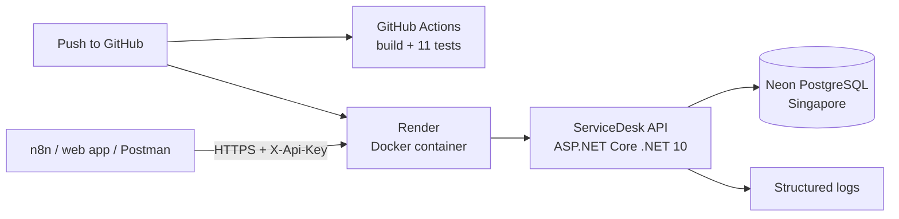

# ServiceDesk API — a documented, tested backend, live with Docker

**Client type:** Coaching business, 1–10 staff (demo project: "Bright Path Coaching")

**Service:** .NET development

## The problem

Bright Path Coaching tracked leads and bookings in spreadsheets. Nothing else could connect to that data,
so every reply, reminder and report was done by hand, and mistakes crept in when two people edited the same sheet.

## What I built

- A REST API for customers, leads and bookings — 15 endpoints with live, interactive API docs
- PostgreSQL storage with EF Core migrations, unique emails, foreign keys and indexes
- Input validation with field-level errors, and one consistent error format (ProblemDetails) — no stack traces leak
- API-key security, paging with a size cap, a health check and structured logs with no personal data
- 11 automated tests that run on every push, and automatic Docker deploys to the cloud

## Result

| Metric | Before | After |
|---|---|---|
| Systems that can use lead/booking data | 0 (spreadsheet only) | Any tool, via a documented REST API |
| Endpoints documented | — | 15, live and interactive |
| Automated tests | — | 11, run on every push (GitHub Actions) |
| Invalid data accepted | Anything typed into the sheet | Rejected with field-level errors |
| Duplicate customers | Possible | Blocked by the database (unique email → 409) |
| Deploy | Manual | Automatic on every push (Docker → Render) |

## How it works

Every later layer — automations, AI triage, payment webhooks — plugs into this one API, so the business has
a single source of truth instead of scattered spreadsheets. Database changes are applied as a deliberate,
separate step, never automatically on a live system.

## Stack

C# · ASP.NET Core (.NET 10) · Entity Framework Core · PostgreSQL (Neon) · FluentValidation · Serilog · xUnit ·
Docker · Render · GitHub Actions

## Demo & code

- ▶️ 60–90 sec video: https://www.loom.com/share/e965400f6e964281bf17b47d6e8a5820
- 🌐 Live API docs: https://servicedesk-api-tpzr.onrender.com/scalar
- ❤️ Health check: https://servicedesk-api-tpzr.onrender.com/health
- 💻 Code: [`/api`](../../api)

_The demo runs on a free plan, so the first request after 15 idle minutes can take up to a minute._

## What I'd do next for a real client

Move to a paid plan so the service never sleeps, add role-based user logins (JWT) for staff,
and set up automated backups and uptime alerts.
