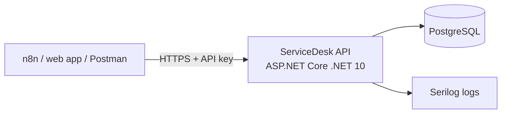

# ServiceDesk API — a documented, secure backend for lead & booking automation

> **Status: DRAFT** — finish on Day 5 with the live link, Loom video and real numbers.

**Client type:** Coaching business, 1–10 staff (demo project: "Bright Path Coaching")
**Service:** .NET development

## The problem

Bright Path Coaching tracked leads and bookings in spreadsheets. Nothing else could connect to that data,
so every reply, reminder and report was done by hand, and mistakes crept in when two people edited the same sheet.

## What I built

- A REST API for customers, leads and bookings, with interactive API docs
- PostgreSQL storage with migrations, so data is consistent and easy to back up
- Input validation, consistent error messages and API-key / JWT security
- Logging, health checks, automated tests and a Docker image for deployment

## Result

| Metric | Before | After |
|---|---|---|
| Systems that can use the lead/booking data | 0 (spreadsheet only) | Any tool via REST API |
| Endpoints documented | — | _[fill on Day 5]_ |
| Automated tests | — | _[fill on Day 5]_ |

## How it works

Every later layer — automations, AI triage, payment webhooks — plugs into this one API, so the business has
a single source of truth instead of scattered spreadsheets.

## Stack

C# · ASP.NET Core (.NET 10) · Entity Framework Core · PostgreSQL · FluentValidation · Serilog · xUnit · Docker

## Demo & code

- ▶️ 60 sec video: _[Loom link — Day 5]_
- 💻 Code: [`/api`](../../api)
- 🌐 Live API docs: _[URL — Day 5]_

## What I'd do next for a real client

Add role-based access for staff, automated backups, and uptime monitoring with alerts.
