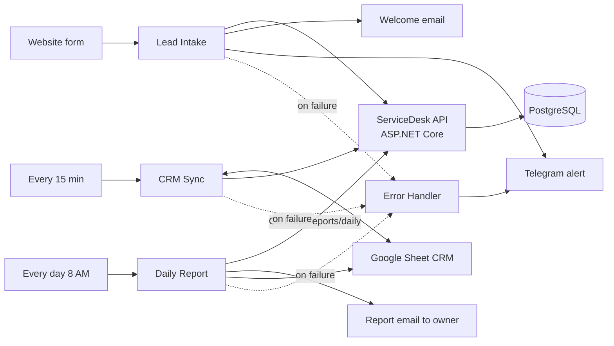

# Automated lead handling — from form to CRM, owner alerts and a daily report, with no copy-paste

**Client type:** Coaching business, 1–10 staff (demo project: "Bright Path Coaching")

**Service:** Workflow automation

## The problem

Enquiries arrived by email and were copied into a spreadsheet by hand. Replies took hours,
the same person was sometimes entered twice, and the owner had no daily view of leads or revenue.

## What I built

- A website form that saves each enquiry to the database through the API, replies to the customer
  by email and pings the owner on Telegram — within seconds
- A Google Sheet "CRM" that fills itself every 15 minutes with no duplicates; a status the owner
  picks in the sheet flows back to the database
- A morning email at 8 AM (India time) with yesterday's leads by source, bookings, revenue and
  pending payments, plus the same numbers as one row per day in a *Reports* tab
- Failure alerts: if any workflow breaks, I get a Telegram message naming the step and the error

## Result

| Metric | Before | After |
|---|---|---|
| First reply to a new enquiry | Hours (manual) | < 1 minute (automatic email), measured in test |
| Owner hears about a new lead | When checking email | Telegram ping in seconds |
| Copy-paste into the CRM sheet | ~1 hr/day (estimated: 15 leads × 4 min) | 0 |
| Duplicate customers | Possible | Prevented (matched by email) |
| Daily numbers | Counted by hand, if at all | Emailed at 8 AM, logged in the sheet |
| Broken automation noticed | When a customer complains | Telegram alert naming the failing step |

_The copy-paste figure is an estimate: 15 leads a day × 4 minutes each. Swap in your own numbers to see your saving._

## How it works

n8n handles forms, schedules and messages; the .NET API owns the data and the counting, so the
numbers in the email, the sheet and any future dashboard always agree. "Yesterday" means yesterday
in India, not in UTC, and the date logic is unit-tested. Every API call retries for cold starts,
re-runs never duplicate rows, and one Error Handler covers all workflows.

## Stack

n8n (self-hosted, Docker) · ASP.NET Core API (.NET 10) · PostgreSQL (Neon) · Google Sheets (service account) ·
Telegram Bot API · SMTP

## Demo & code

- ▶️ 90-sec video: https://www.loom.com/share/3dd8788069004ab7909ea9e9407cc0e3
- 💻 Workflows: [`/automations`](../../automations)
- 🌐 API docs: https://servicedesk-api-tpzr.onrender.com/scalar

_The demo API runs on a free plan, so the first request after 15 idle minutes can take up to a minute._

## What I'd do next for a real client

Host n8n (n8n Cloud or a small VPS) so schedules run 24/7, add a weekly summary, and hand over
a one-page runbook: where each credential lives and what each alert means.
