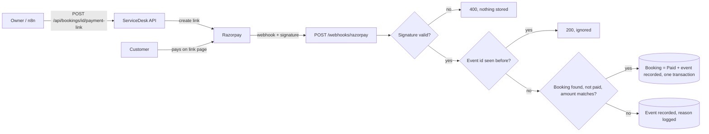
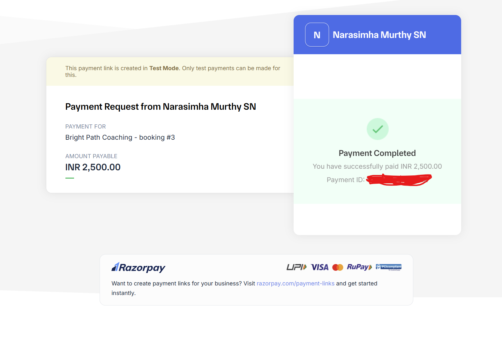
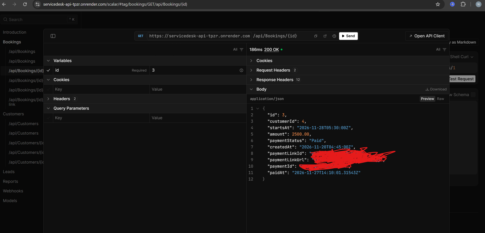
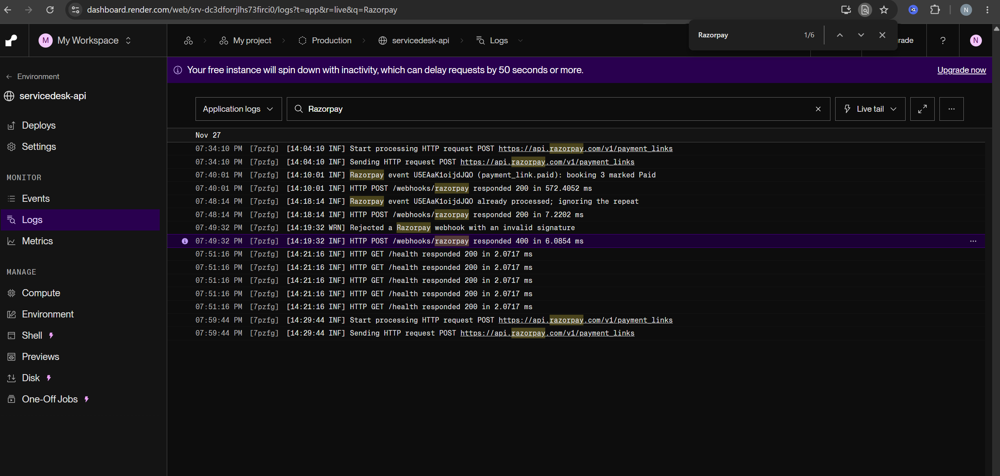

# Razorpay payments that can't be faked or counted twice

**Client type:** Coaching business, 1–10 staff (demo project: "Bright Path Coaching")

**Service:** Database & API work — third-party payment integration

## The problem

Sessions were paid by bank transfer or UPI and matched to bookings by hand. Moving to Razorpay
Payment Links fixes the collecting, but a naive webhook brings two risks: anyone who finds the URL
can post a fake "payment received", and Razorpay retries deliveries, so one payment can be
recorded twice.

## What I built

- A payment link per booking, created through the Razorpay API (one link per booking, safe to call twice)
- A webhook that accepts only requests signed by Razorpay (HMAC-SHA256 over the raw body,
  constant-time comparison)
- Exactly-once processing: every event id is stored with the booking update in one transaction,
  so a retried or duplicated event changes nothing
- Safety checks: a booking already paid stays untouched, and a payment whose amount doesn't match
  the booking is logged, not applied

## Result

| Check | Result |
|---|---|
| Real test-mode payment (₹2,500) | Booking marked Paid within seconds of paying |
| Same event delivered again (a retry) | Ignored, booking unchanged |
| Different event for an already-paid booking | Ignored, booking unchanged |
| Paid amount ≠ booking amount | Logged as a mismatch, booking stays Pending |
| Body changed after signing / wrong secret / no signature | Rejected with 400, nothing stored |
| Matching bookings to payments by hand | No longer needed |
| Automated tests | 30 in total (10 new for payments), run on every push |

_All payments are Razorpay Test Mode: no real money moved._

## How it works

The webhook can't send the API key the rest of the API requires, so it is the one endpoint that skips
it — and authenticates Razorpay by signature instead. Answering 200 to every valid event, even one we
ignore, stops Razorpay from retrying it forever.

## Stack

ASP.NET Core (.NET 10) · Razorpay Payment Links API + webhooks (test mode) · EF Core · PostgreSQL (Neon) · xUnit

## Demo & code

- 💻 Code: [`WebhooksController`](../../api/src/ServiceDesk.Api/Controllers/WebhooksController.cs),
  [`RazorpaySignature`](../../api/src/ServiceDesk.Api/Payments/RazorpaySignature.cs),
  [`RazorpayClient`](../../api/src/ServiceDesk.Api/Payments/RazorpayClient.cs)
- 🧪 Test tool: [`tools/send-razorpay-test-webhook.ps1`](../../tools/send-razorpay-test-webhook.ps1) —
  sends a correctly signed, replayed or tampered event
- 🌐 API docs: https://servicedesk-api-tpzr.onrender.com/scalar

_The demo API runs on a free plan: a payment made while it sleeps may time out on Razorpay's first
delivery; Razorpay retries and the booking is still marked Paid exactly once._

## What I'd do next for a real client

Switch to live keys after a test-mode sign-off, send the customer a receipt and the owner a Telegram
note on each payment, report revenue by payment date (`PaidAt`), and reconcile daily against
Razorpay's payments list in case a webhook was ever missed.
